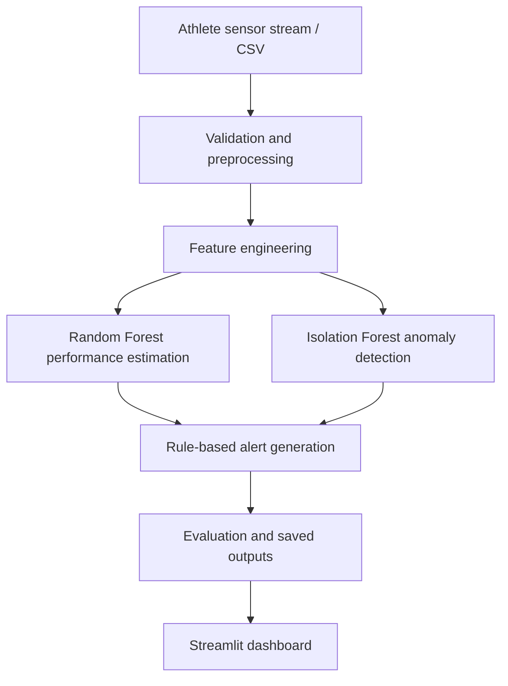

# System architecture

The current code simulates sequential sensor records and processes a CSV batch. It is a real-time analytics prototype, not a production streaming infrastructure such as Kafka or MQTT. Update this diagram if the implementation changes.
